<p align="center">
  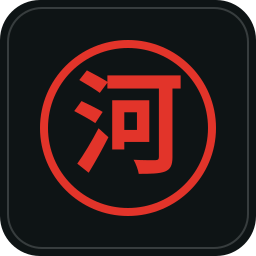
</p>

<h1 align="center">Kappa File Manager (河)</h1>

A brutalist, high-performance file manager made **for** the **Ryoku OS** ecosystem, with a **Rust** backend and a native **QML / Quickshell** interface.

> Version **0.1.0-beta**. Kappa is an independent community project. It is **not an official Ryoku app** and is not maintained by the Ryoku team.

Inspired by the depth and robustness of **KDE Dolphin**, Kappa takes Dolphin's best ideas (transparent device browsing, KIO-Fuse, KDE Connect integration, XDG places, a clean separation of model and view) and rebuilds them from scratch on a fast **Rust 2024** core, wearing the Ryoku design system.

---

## Screenshots

| | |
| :---: | :---: |
| 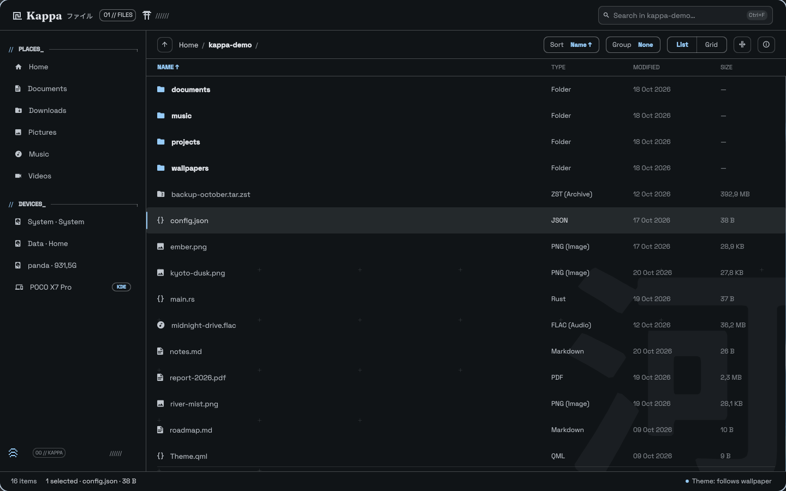<br>**List view** | 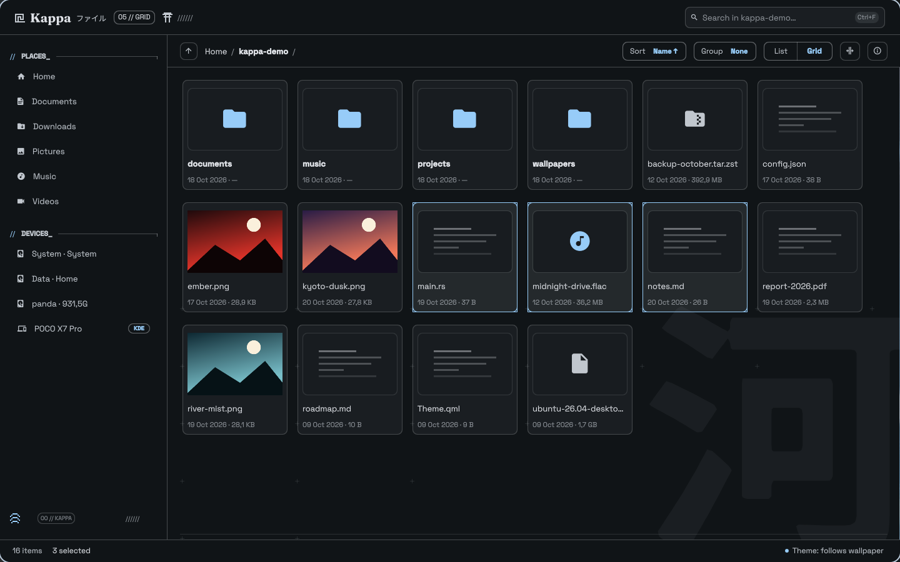<br>**Grid view and multi-selection** |
| 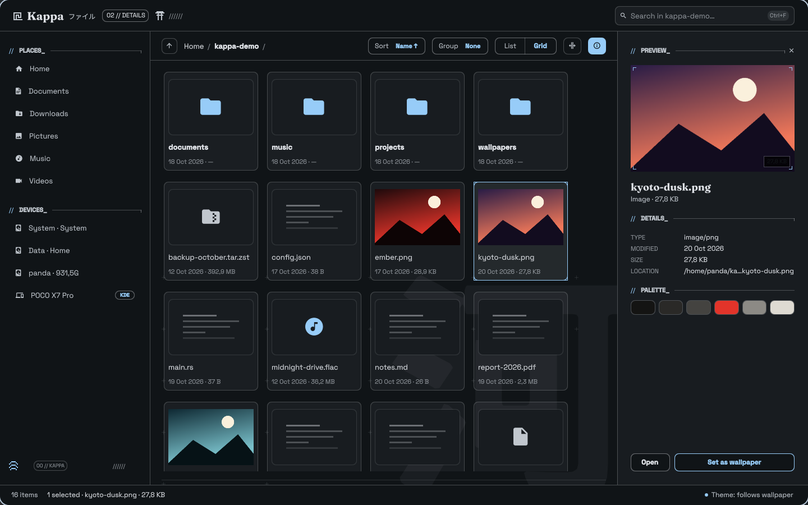<br>**Details panel** | 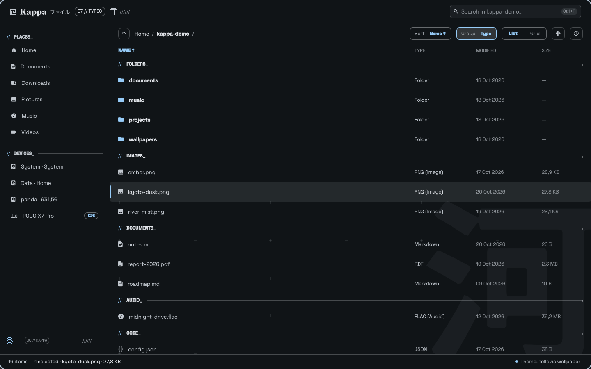<br>**Grouped by type** |
| 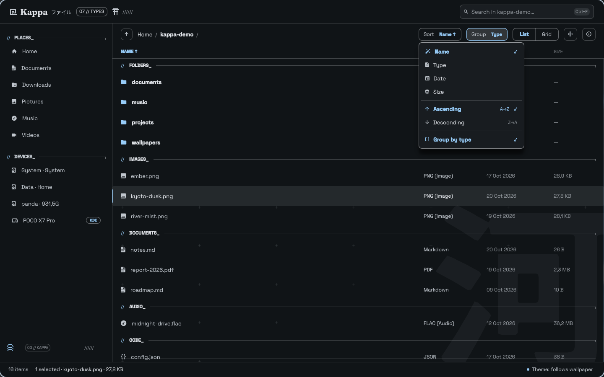<br>**Sort menu** | 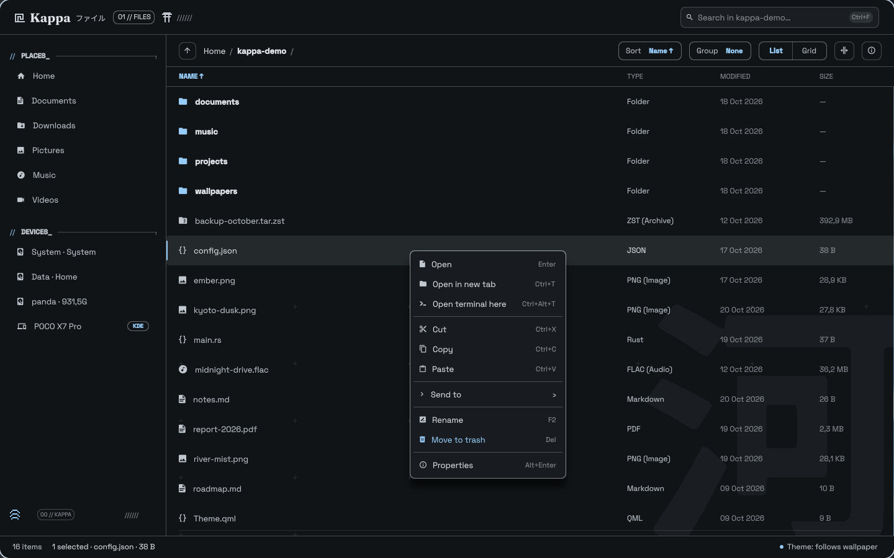<br>**Context menu** |
| 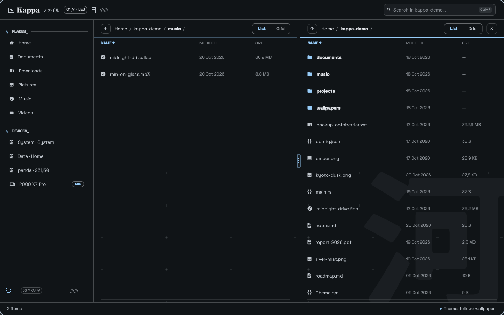<br>**Split view (F3)** | 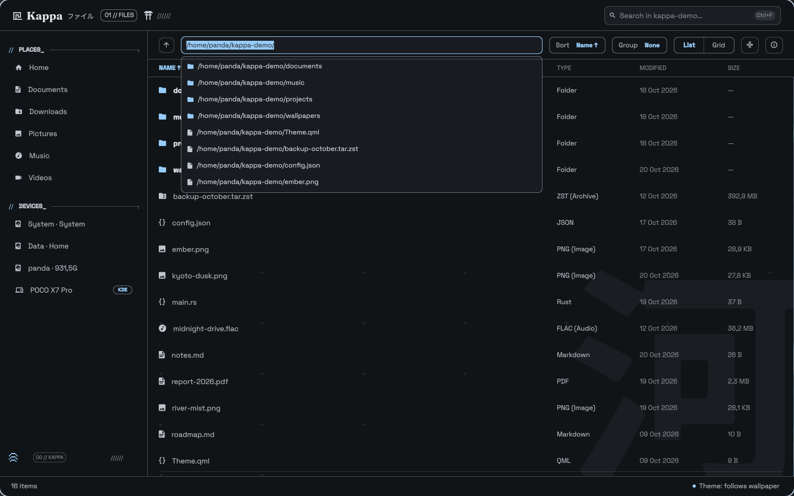<br>**Editable path bar with suggestions** |
| 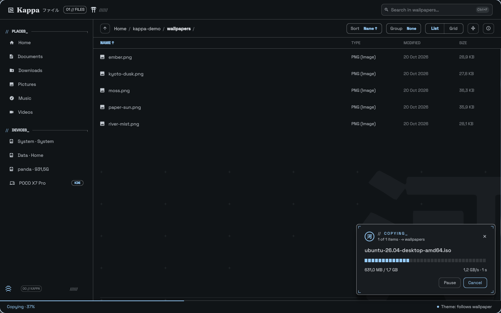<br>**Copy in progress** | 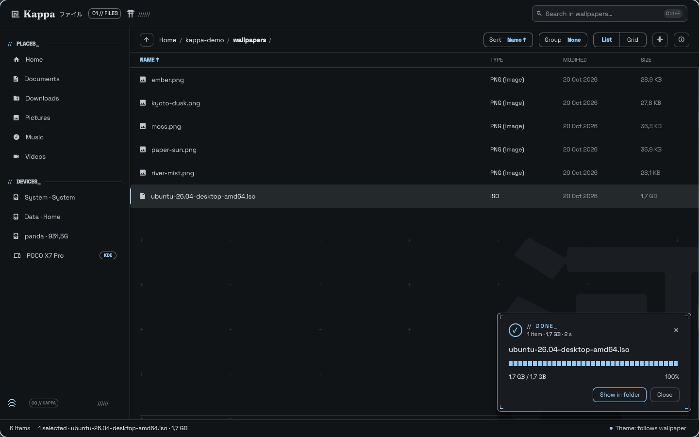<br>**Copy finished** |
| 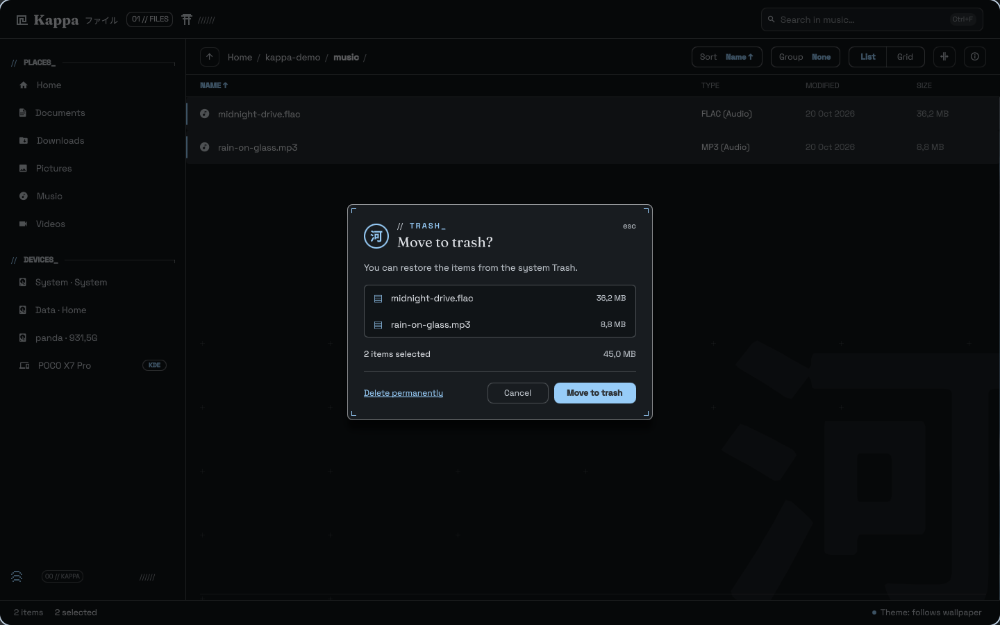<br>**Delete confirmation** | 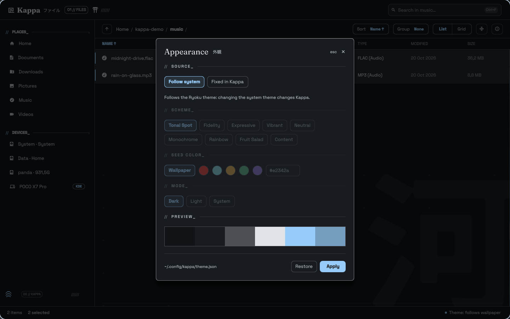<br>**Appearance** |
| 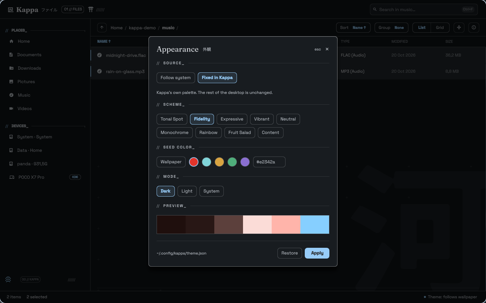<br>**Kappa-only theme (Fidelity scheme)** | 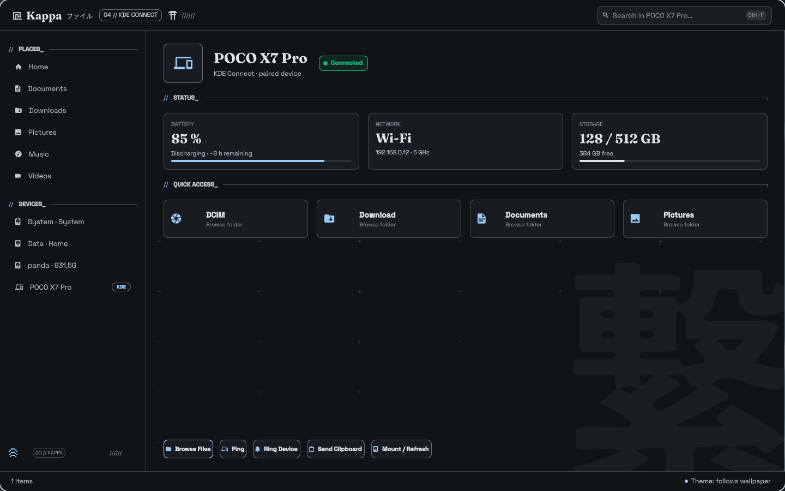<br>**KDE Connect device** |

---

## Features

- **Pure Rust core:** fast asynchronous scanning, inotify watching without reloading the view, safe trash (FreeDesktop Trash spec) and on-the-fly metadata.
- **Dolphin's spirit, in Rust:** access to remote systems and devices through `kio-fuse` and DBus, so a phone's file system can be browsed like a local folder.
- **Ryoku visual language ("Greek-noir yakuza"):** corner radius taken from the Ryoku configuration, 1px hairlines, soft shadows, a vermillion *Hanko* (*eki-stamp*) seal, a monumental 河 kanji in the background and blueprint registration marks (+).
- **Tabs:** a clean single-window view by default; the tab bar slides in when there is more than one tab (`Ctrl+T`, `Ctrl+W`).
- **Split view (`F3`):** two folders side by side with independent navigation and a draggable divider.
- **Inline search:** live filtering with a 150 ms debounce, category chips with live counts and a scope switch (*This folder* or *Everything*).
- **Multi-selection:** `Ctrl+click` toggles, `Shift+click` and `Shift+arrows` select ranges, `Ctrl+A` selects everything. Copy, cut, paste and delete act on every selected item.
- **Transfers with progress:** copy and move show a progress card with speed and time remaining, can be paused, and can be cancelled with `Esc`, including for multi-gigabyte files.
- **Safe deletion:** `Del` opens a confirmation and moves items to the trash; `Shift+Del` deletes permanently after an explicit confirmation.
- **Usable path bar:** click an empty area or press `Ctrl+L` to type a path, with suggestions, `Tab` completion and a clear message for paths that do not exist.
- **Sorting and grouping:** sort by name, type, date or size (ascending or descending) and group by type with live section counts.
- **Details panel:** a sliding drawer (`Ctrl+I`) with a large preview, MIME type, location and a color palette for images, plus a "set as wallpaper" action.
- **Own appearance:** `Ctrl+,` lets Kappa follow the Ryoku theme or use its own palette (scheme, seed color and light/dark mode) without changing the rest of the desktop.
- **KDE Connect and KIO-Fuse:** live detection of paired devices, browsing of the phone's folders, sending files from the context menu, ping, ring, clipboard sharing and mounting.
- **Ryoku internationalization:** follows the system language from `~/.config/ryoku/shell.json` (English or Portuguese).

---

## Architecture

Kappa has two decoupled layers.

1. **Rust core (`src/`):**
   - [`src/core/entry.rs`](src/core/entry.rs): file model, MIME types and locale-aware date and size formatting.
   - [`src/core/path_resolver.rs`](src/core/path_resolver.rs): path validation (suggestions for existing folders, permission checks, broken symlinks and disconnected disks) and autocomplete.
   - [`src/core/search.rs`](src/core/search.rs): asynchronous search engine with instant cancellation through an `AtomicBool`.
   - [`src/core/places.rs`](src/core/places.rs): default system places, mounted devices and KDE Connect devices.
   - [`src/ops/file_ops.rs`](src/ops/file_ops.rs): open, trash, permanent delete, rename and folder creation.
   - [`src/ops/transfer.rs`](src/ops/transfer.rs): batch copy and move that emits JSON progress events.

2. **Interface (`qml/`, QML / Quickshell):**
   - Consumes the system tokens installed under `/usr/lib/qt6/qml/Ryoku/` (`Tokens.qml`, `I18n.qml`).
   - [`qml/KappaTheme.qml`](qml/KappaTheme.qml) wraps those tokens so Kappa can follow the Ryoku theme or use its own palette.
   - Pixel-art vectors with `QtQuick.Shapes` ([`qml/PixelGlyphs.qml`](qml/PixelGlyphs.qml)), registration-cross grid ([`qml/TechCrosses.qml`](qml/TechCrosses.qml)) and the oriental seal ([`qml/HankoSeal.qml`](qml/HankoSeal.qml)).

The interface talks to the backend through a small command-line interface that prints JSON, read with `Quickshell.Io.Process`.

---

## Getting Started

### Requirements

- **Ryoku OS** (provides the `ryoku-desktop` package with the `Ryoku.Ui` QML module), **Quickshell** and **Qt 6**
- **Rust and Cargo** (edition 2024) to build from source
- Optional: `kdeconnect` and `kio-fuse` for phone integration, `matugen` for the Kappa-only theme, `swww` for "set as wallpaper"

### Install on Arch Linux (AUR)

```bash
paru -S kappa-file-manager
# or
yay -S kappa-file-manager
```

Or build the package straight from this repository:

```bash
git clone https://github.com/satodu/kappa-file-manager.git
cd kappa-file-manager/packaging/aur
makepkg -si
```

Then start **Kappa** from your launcher, or run `kappa-file-manager`.

### Run from source

```bash
git clone https://github.com/satodu/kappa-file-manager.git
cd kappa-file-manager
./run.sh
```

Or build the backend and start Quickshell yourself:

```bash
cargo build
quickshell -p qml/shell.qml
```

The interface finds the backend through `KAPPA_BACKEND` and falls back to `target/debug/` next to the `qml/` folder. For testing, `KAPPA_START=<folder>` sets the starting folder and `KAPPA_VIEW=list|grid` sets the initial view.

### Known limitations (beta)

- The battery, network and storage figures on the KDE Connect device screen are placeholder values taken from the design; actions such as ping and ring call the real `kdeconnect-cli`.
- "Open terminal here" uses `$TERMINAL` or the first terminal it finds (`ghostty`, `kitty`, `alacritty`, `foot`, `konsole`, `xterm`).

---

## Keyboard Shortcuts

| Shortcut | Action |
| :--- | :--- |
| `Ctrl+T` | Open a new tab in the current folder |
| `Ctrl+W` | Close the active tab |
| `Ctrl+F` | Focus the inline search |
| `Ctrl+L` or `Alt+D` | Edit the path |
| `Esc` | Clear search, close menus and dialogs, cancel a transfer |
| `Enter` | Open the selected folder or file with the default application |
| `Ctrl+C` / `Ctrl+X` / `Ctrl+V` | Copy / cut / paste |
| `Ctrl+A` | Select everything |
| `Del` / `Shift+Del` | Move to trash (with confirmation) / delete permanently |
| `F2` | Rename |
| `F7` or `Ctrl+Shift+N` | New folder (opens ready to rename) |
| `F3` | Split view |
| `Ctrl+I` or `Alt+Enter` | Toggle the details panel |
| `Ctrl+H` | Show or hide hidden files |
| `Ctrl+,` | Open Appearance |

---

## Design System and Customization

- **Dynamic corner radius:** every component follows the radius configured in Ryoku (`~/.config/ryoku/shell.json`, `theme.attributes.sizing.radius_widget`, falling back to `Tokens.radius`).
- **Appearance:** Kappa follows the Ryoku theme by default. In **Fixed in Kappa** mode it generates its own Material palette with `matugen` (scheme, seed color, light or dark) and stores it in `~/.config/kappa/theme.json`.
- **Sorting and grouping:** the **Sort** button opens a menu to sort by **Name**, **Type**, **Date** or **Size**, ascending or descending; column headers are clickable. **Group by type** creates sections (`FOLDERS_`, `IMAGES_`, `DOCUMENTS_`, `AUDIO_`, `VIDEOS_`, `CODE_`, `OTHER_`) with live counts.
- **Context menu:** open, open in a new tab, open a terminal here, cut, copy, paste, send to (KDE Connect devices, USB drives, zip, clipboard), rename, trash and properties, plus a dedicated section for audio tracks that plays them in Ryotunes.

---

## License

Kappa is released under the [BSD Zero Clause License (0BSD)](LICENSE): you may use, copy, modify and distribute it for any purpose, with no attribution required.

---

## Design and Credits

- The original design was created in **FigCraft** and lives in [`design/kappa-file-manager.figcraft`](design/kappa-file-manager.figcraft).
- Kappa follows the visual identity and guidelines of **Ryoku** but is an independent project and is not officially affiliated with it.
